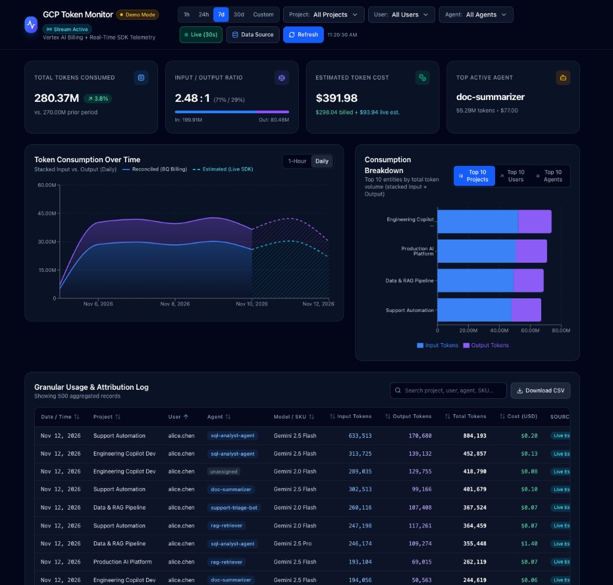
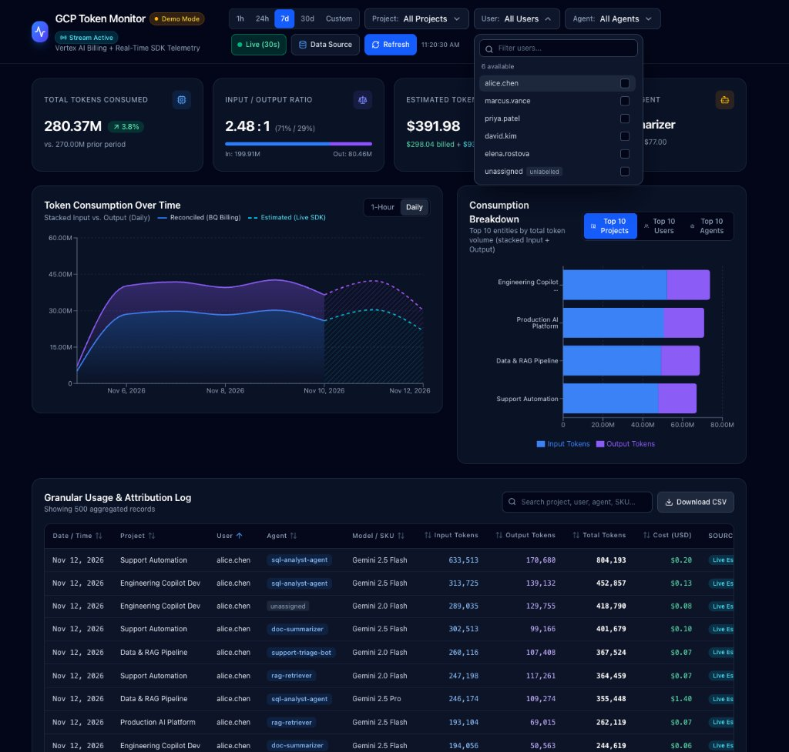
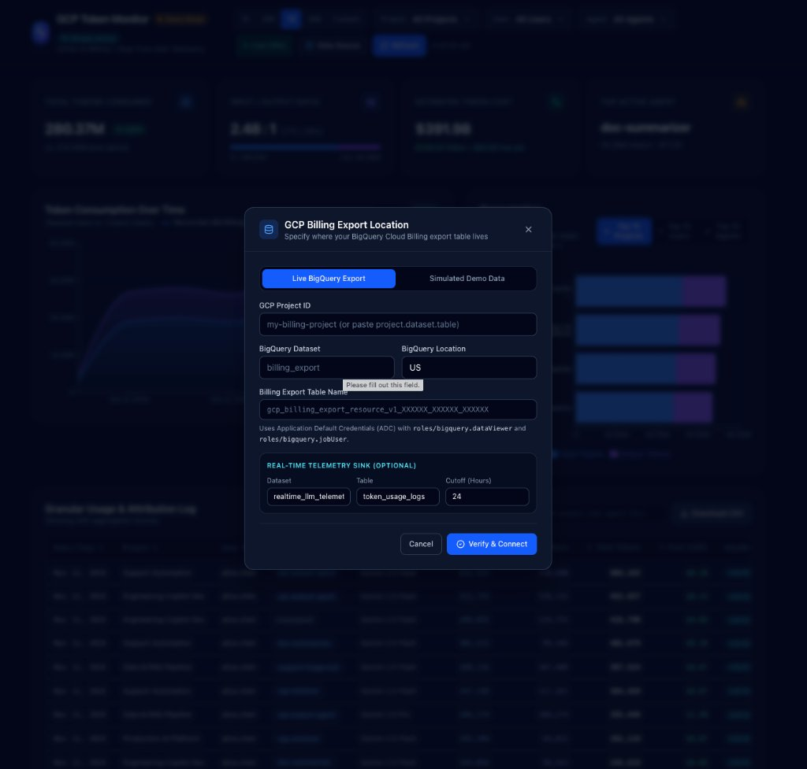

# GCP Token Monitor — Sales & Customer Demo Guide

Use this guide to run a crisp, 10-minute live demo of **GCP Token Monitor** for FinOps leaders, Platform Engineering teams, and AI/ML stakeholders.

---

## 1. The 30-Second Pitch

> *"As teams scale Gemini and Vertex AI agents into production, two blind spots emerge immediately: GCP Cloud Billing takes 12–24 hours to export, and native billing only tells you which **project** spent money—not which **user**, **AI agent**, or **prompt loop** caused a spike. **GCP Token Monitor** solves both by combining finalized BigQuery billing exports with live SDK telemetry in a single dashboard—giving you real-time operational visibility today and finance-grade reconciled costs for yesterday, with zero extra infrastructure."*

### Key Customer Pain Points Solved
| Pain Point | How GCP Token Monitor Solves It |
| :--- | :--- |
| **12–24h Billing Delay** | Streams `usageMetadata` via Cloud Logging into BigQuery for minute-level visibility in seconds. |
| **No User/Agent Attribution** | Extracts `user_id` and `agent_id` from Vertex AI request `labels` (with `'unassigned'` fallback for legacy calls). |
| **Double-Counting & Cost Confusion** | Uses a configurable cutoff (`REALTIME_CUTOFF_HOURS`) to separate **Reconciled (BQ Billing)** from **Estimated (Live SDK)**. |
| **High BigQuery Scan Costs** | Enforces `_PARTITIONTIME` and `usage_start_time` partition pruning on every query. |
| **Heavy Infrastructure Overhead** | Runs serverlessly on Cloud Run + BigQuery—no Kafka, Redis, or separate time-series database required. |

---

## 2. Pre-Demo Setup (1 Minute)

Choose either **Cloud Run (Authenticated Proxy)** or **Local Demo Mode**:

- **Option A — Deployed Cloud Run Instance** (recommended):
  ```bash
  gcloud run services proxy token-monitor \
    --region us-central1 \
    --project <YOUR_GCP_PROJECT_ID> \
    --port 8080
  ```
  Open `http://localhost:8080`. If prompted by the **GCP Billing Export Location** dialog, select **Simulated Demo Data** (or connect your live billing export table).

- **Option B — Local Dev Mode**:
  ```bash
  DEMO_MODE=true npm run dev
  ```
  Open `http://localhost:5173`.

> **Tip:** Before the call, verify the top-left badges show **Demo Mode** (or **BigQuery Live**) and **Stream Active**, and set the date preset to **7d**.

---

## 3. 10-Minute Live Demo Script

### Scene 1: Executive KPIs & Cost Confidence (2 mins)


1. **Point to the 4 KPI Cards at the top**:
   - **Total Tokens Consumed** (with `%` change vs. the prior period): *"Instantly see whether token volume is trending up or down compared to last week."*
   - **Input / Output Ratio**: *"Track prompt bloat vs. generation volume—crucial for spotting oversized RAG context windows."*
   - **Estimated Token Cost**: *"Notice the split right under the total—`$298.04 billed + $93.94 live est.` Finance gets reconciled invoice accuracy for past days, while engineering gets live spend estimates for today."*
   - **Top Active Agent**: *"Immediately surfaces which AI agent is driving the most volume."*

---

### Scene 2: Eliminating the 24-Hour Billing Blind Spot (3 mins)
1. **Point to the "Token Consumption Over Time" chart**:
   - Highlight the **solid area** (**Reconciled — BQ Billing**) on the left transitioning into the **dashed, hatched area** (**Estimated — Live SDK**) on the right.
   - Hover over a live bucket to show the tooltip badge: *"Estimated from live SDK telemetry — pending BQ billing reconciliation."*
   - **Talk Track**: *"Once BigQuery Billing catches up after 24 hours, the cutoff shifts automatically—so you never double-count a single token."*
2. **Switch to Real-Time Incident Mode**:
   - Click the **1h** preset in the top bar.
   - Notice the chart automatically switches to **1-Min** granularity.
   - Toggle **Live (30s)** in the top bar: *"During an incident or a new agent rollout, an SRE can leave this on Live (30s) and watch minute-by-minute token burn in real time."*

---

### Scene 3: Multi-Dimensional Attribution & Chargeback (2 mins)


1. **Click through the "Consumption Breakdown" tabs** on the right:
   - **Top 10 Projects** → **Top 10 Users** → **Top 10 Agents** → **Top 10 Models**.
   - **Talk Track**: *"Out of the box, GCP billing stops at the Project level. By passing `user_id` and `agent_id` labels, you get full showback and chargeback across teams, individual power users, autonomous agents, and Gemini models."*
2. **Open the `User` or `Agent` multi-select filter** in the top bar:
   - Show the search box and the `unassigned` (`unlabelled`) tag.
   - **Talk Track**: *"If you have legacy services that aren't tagged yet, nothing breaks—they roll up cleanly under `unassigned` so you know exactly how much unattributed spend remains to be tagged."*

---

### Scene 4: Auditability & 2-Minute Customer Onboarding (3 mins)
1. **Scroll to the "Granular Usage & Attribution Log" table**:
   - Sort by **Total Tokens** or **Cost (USD)**, search for a model like `Gemini 2.5 Pro`, point out the **Source** column (`Reconciled` vs `Live Est.`), and click **Download CSV** to show Finance-ready exports.
2. **Click "Data Source" in the top bar**:
   
   - **Talk Track**: *"Deploying this in your own environment takes minutes. Point it at your existing BigQuery Cloud Billing export table—you can even paste `project.dataset.table` directly—and the app verifies IAM access and automatically provisions the partitioned `realtime_llm_telemetry` BigQuery table if it doesn't exist yet."*

---

## 4. Handling Common Customer Questions

- **"Will querying our Cloud Billing table cost a fortune in BigQuery?"**
  No. Every query in [sql/queries.sql](sql/queries.sql) prunes on both `_PARTITIONTIME` and `usage_start_time`, uses column pruning, and extracts labels with scalar subqueries (preventing row multiplication).
- **"How do we send real-time telemetry without building a Kafka pipeline?"**
  Drop our lightweight wrapper ([Python](instrumentation/python/gemini_telemetry.py) or [Node.js](instrumentation/node/geminiTelemetry.ts)) around `generateContent` / `generateContentStream`. It logs `usageMetadata` to Cloud Logging, and a single Cloud Logging Sink streams it straight into BigQuery.
- **"Is it secure for internal financial data?"**
  Yes. It deploys to Cloud Run with `--no-allow-unauthenticated` (IAM / IAP gated), uses Application Default Credentials (ADC), and requires only `roles/bigquery.dataViewer` and `roles/bigquery.jobUser`.

---

## 5. Next Steps (Customer POC)

Offer to deploy **GCP Token Monitor** into the customer's sandbox or FinOps project in under 10 minutes using [DEPLOY_GCP.md](./DEPLOY_GCP.md) or the **Quick Deploy with Antigravity** workflow in [README.md](./README.md).
