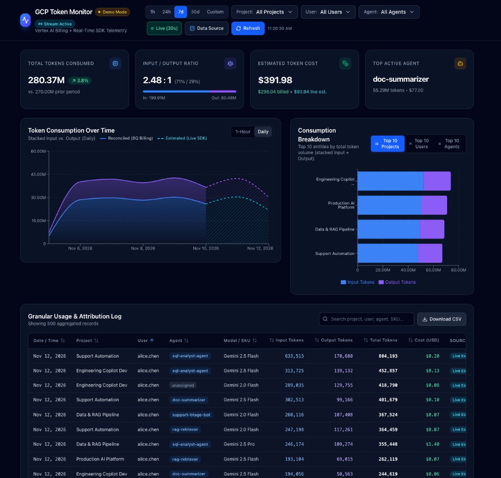
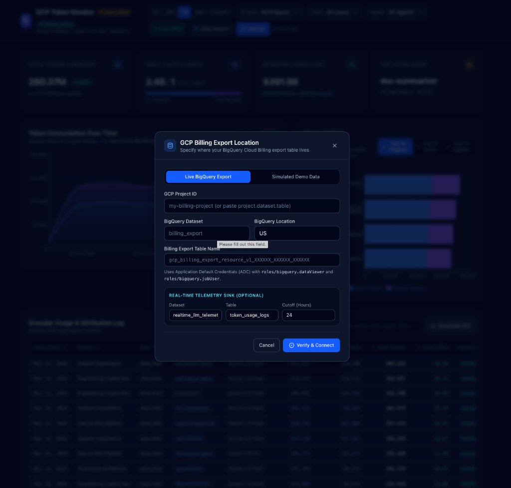
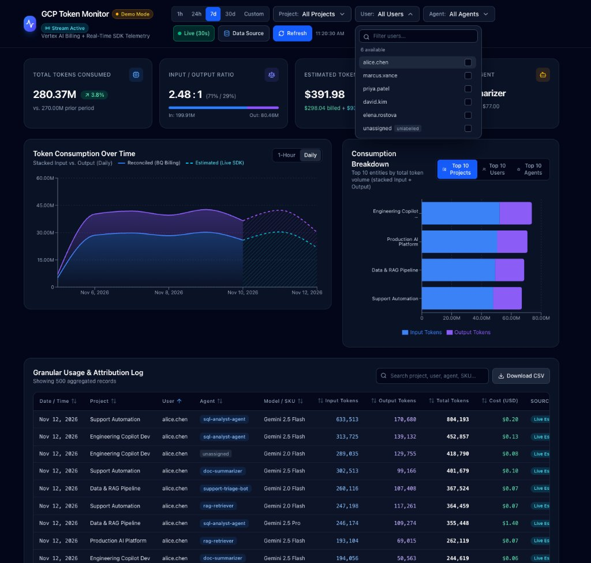

# GCP Token Monitor — Vertex AI & Gemini Usage Analytics

A full-stack observability dashboard that monitors LLM token usage and cost in Google Cloud Platform (GCP) using a **Lambda / Hybrid Architecture**:

- **Authoritative Historical Costs (`billing_reconciled`)**: Queries the BigQuery Cloud Billing Detailed Usage Cost export (`gcp_billing_export_resource_v1_<BILLING_ACCOUNT_ID>`) for finalized invoice costs, discounts, and credits.
- **Real-Time Live Telemetry (`realtime_estimated`)**: Queries a partitioned BigQuery streaming table (`realtime_llm_telemetry.token_usage_logs`) fed by a Cloud Logging Sink from your SDK wrappers, eliminating the 12–24 hour billing export delay.

---

## Quick Deploy with Antigravity

The fastest way to deploy **GCP Token Monitor** to your Google Cloud project is using **Google Antigravity**:

1. **Authenticate `gcloud` locally** (one-time prerequisite):
   ```bash
   gcloud auth login
   ```
2. **Open this repository in Antigravity** and send the following prompt:
   > `Deploy TokenMonitor to my GCP project ID: <YOUR_GCP_PROJECT_ID>`
3. **What Antigravity will automate for you**:
   - Enables the required GCP APIs (`run`, `cloudbuild`, `artifactregistry`, `bigquery`, `logging`).
   - Creates the `token-monitor-sa` Service Account with least-privilege BigQuery IAM roles (`roles/bigquery.jobUser`, `roles/bigquery.dataViewer`, `roles/bigquery.dataEditor`) and configures Cloud Build permissions.
   - Creates the `realtime_llm_telemetry` BigQuery dataset and `token-monitor-realtime-sink` Cloud Logging Sink.
   - Builds and deploys the container to **Cloud Run** (`--no-allow-unauthenticated`) and verifies `/api/health` and `/api/config`.
4. **Open your deployed dashboard**:
   ```bash
   gcloud run services proxy token-monitor --region us-central1 --project <YOUR_GCP_PROJECT_ID> --port 8080
   ```
   Open `http://localhost:8080` and enter your BigQuery Cloud Billing export `project.dataset.table` in the **GCP Billing Export Location** dialog (or select **Simulated Demo Data**).

---

## Screenshots

### Hybrid Dashboard (Reconciled Billing + Live SDK Telemetry)


### Interactive BigQuery Billing Export & Real-Time Sink Setup


### Multi-Select Attribution Filters (Project, User, Agent)


---

## Architecture & Key Files

- **Frontend (`client/`)**: React 18, TypeScript, Vite, Tailwind CSS, Recharts, Lucide Icons.
  - Interactive **Data Source** dialog ([BillingConfigModal.tsx](client/src/components/BillingConfigModal.tsx)) that prompts for your BigQuery billing export location on startup if unconfigured, or lets you switch between Live BigQuery and Demo Mode anytime.
  - **Live (30s)** auto-refresh toggle, stream health badge (`Stream Active` / `Stream Degraded` / `Billing Only`), **1h / 24h / 7d / 30d / Custom** date presets, and **1-Min / 1-Hour / Daily** chart granularity.
  - Visual distinction on time-series charts: solid areas for **Reconciled (BQ Billing)** and dashed/hatched areas for **Estimated (Live SDK)**.
- **Backend (`server/`)**: Node.js, Express, TypeScript, `@google-cloud/bigquery` with Application Default Credentials (ADC).
  - Hybrid reconciliation engine ([client.ts](server/src/bigquery/client.ts)) with a configurable `REALTIME_CUTOFF_HOURS` boundary (default `24`) to prevent double-counting.
  - Auto-provisions the `realtime_llm_telemetry` dataset and day-partitioned `token_usage_logs` table on startup or when saving Live BigQuery settings if they do not exist yet.
- **SQL (`sql/`)**:
  - [sql/queries.sql](sql/queries.sql): Partition-pruned BigQuery Billing SQL using `_PARTITIONTIME` + `usage_start_time`, scalar `UNNEST(labels)` subqueries, and `'unassigned'` fallback handling.
  - [sql/realtime_telemetry.sql](sql/realtime_telemetry.sql): Minute/hour/day real-time telemetry aggregation with a `model_pricing` lookup CTE.
- **SDK Instrumentation (`instrumentation/`)**:
  - [instrumentation/python/gemini_telemetry.py](instrumentation/python/gemini_telemetry.py) (`google-genai`)
  - [instrumentation/node/geminiTelemetry.ts](instrumentation/node/geminiTelemetry.ts) (`@google/genai`)

---

## 1. GCP IAM & BigQuery Prerequisites

1. **Enable Cloud Billing Export to BigQuery**:
   In the GCP Console, go to **Billing → Billing export → BigQuery export** and enable **Detailed usage cost**. Note your dataset and table name (`gcp_billing_export_resource_v1_XXXXXX_XXXXXX_XXXXXX`).
2. **Grant Required IAM Roles**:
   The principal (user or service account) running the backend needs:
   - `roles/bigquery.dataViewer` — to read the billing export table.
   - `roles/bigquery.jobUser` — to run BigQuery query jobs.
   - `roles/bigquery.dataEditor` *(optional, for auto-provisioning)* — allows the app to automatically create `realtime_llm_telemetry.token_usage_logs` if missing.

   ```bash
   gcloud projects add-iam-policy-binding YOUR_GCP_PROJECT_ID \
     --member="serviceAccount:token-monitor@YOUR_GCP_PROJECT_ID.iam.gserviceaccount.com" \
     --role="roles/bigquery.dataViewer"

   gcloud projects add-iam-policy-binding YOUR_GCP_PROJECT_ID \
     --member="serviceAccount:token-monitor@YOUR_GCP_PROJECT_ID.iam.gserviceaccount.com" \
     --role="roles/bigquery.jobUser"

   gcloud projects add-iam-policy-binding YOUR_GCP_PROJECT_ID \
     --member="serviceAccount:token-monitor@YOUR_GCP_PROJECT_ID.iam.gserviceaccount.com" \
     --role="roles/bigquery.dataEditor"
   ```

3. **Configure Application Default Credentials (ADC)**:
   - **Local development**:
     ```bash
     gcloud auth application-default login
     ```
   - **Production / Service Account**:
     Set `GOOGLE_APPLICATION_CREDENTIALS=/path/to/service-account-key.json` or attach the service account to Cloud Run / GKE / GCE.

---

## 2. Attribution: Labels + Real-Time SDK Telemetry

### A. Tagging Vertex AI Requests with `labels` (For Billing Export)
GCP Cloud Billing exports do not natively track end-users or AI agents. Pass `user_id` and `agent_id` in `labels` so they flow into BigQuery's `labels` array (requests without labels fall back to `'unassigned'`):

**Python (`google-genai`)**:
```python
from google import genai
from google.genai.types import GenerateContentConfig

client = genai.Client(vertexai=True, project="your-gcp-project-id", location="us-central1")
response = client.models.generate_content(
    model="gemini-2.5-flash",
    contents="Summarize the latest architecture review.",
    config=GenerateContentConfig(
        labels={"user_id": "alice.chen", "agent_id": "doc-summarizer"}
    ),
)
```

**Node.js (`@google/genai`)**:
```ts
import { GoogleGenAI } from '@google/genai';

const ai = new GoogleGenAI({ vertexai: true, project: 'your-gcp-project-id', location: 'us-central1' });
const response = await ai.models.generateContent({
  model: 'gemini-2.5-flash',
  contents: 'Summarize the latest architecture review.',
  config: {
    labels: { user_id: 'alice.chen', agent_id: 'doc-summarizer' },
  },
});
```

### B. Streaming Real-Time Telemetry via SDK Wrappers
Use the wrappers in `instrumentation/` to intercept `generateContent` and `generateContentStream`, extract `usageMetadata` (`promptTokenCount`, `candidatesTokenCount`, `cachedContentTokenCount`, `totalTokenCount`), and emit structured logs to Cloud Logging:

- **Python**: `generate_content_with_telemetry` / `generate_content_stream_with_telemetry` in [gemini_telemetry.py](instrumentation/python/gemini_telemetry.py).
- **Node.js**: `generateContentWithTelemetry` / `generateContentStreamWithTelemetry` in [geminiTelemetry.ts](instrumentation/node/geminiTelemetry.ts).

---

## 3. Local Setup & Running

1. **Install dependencies**:
   ```bash
   npm install
   npm run install:all
   ```

2. **Configure environment variables** *(optional — you can also configure the BigQuery export location directly in the UI)*:
   ```bash
   cp .env.example .env
   ```
   Edit `.env`:
   - For **live BigQuery**: set `DEMO_MODE=false` and fill in `GCP_PROJECT_ID`, `BQ_DATASET`, `BQ_TABLE`, `BQ_LOCATION` (and optionally `BQ_REALTIME_DATASET`, `BQ_REALTIME_TABLE`, `REALTIME_CUTOFF_HOURS`).
   - For **local demo data** (no GCP credentials required): keep `DEMO_MODE=true`.

3. **Start development servers** (Backend on `:4000`, Frontend on `:5173`):
   ```bash
   npm run dev
   ```

4. **Production Build & Start**:
   ```bash
   npm run build
   npm start
   ```
   In production mode, Express serves the compiled React bundle from `client/dist` on `PORT` (default `4000`).

---

## 4. Deploying to Google Cloud (Cloud Run)

See [DEPLOY_GCP.md](./DEPLOY_GCP.md) for complete step-by-step instructions to deploy to Cloud Run using the included `Dockerfile`, configure the Cloud Logging Sink into BigQuery, set up least-privilege Service Account IAM bindings, and secure access.
