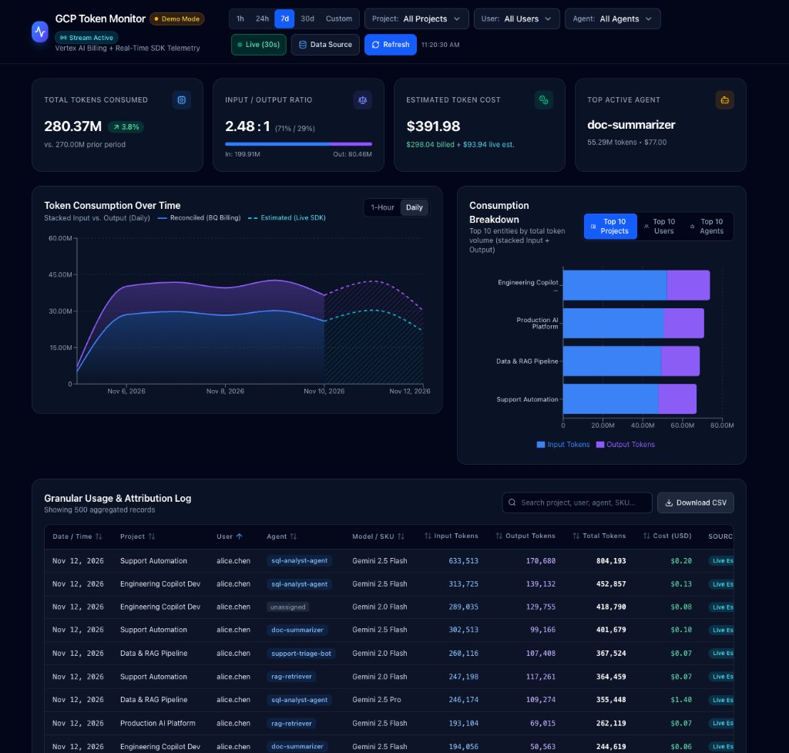
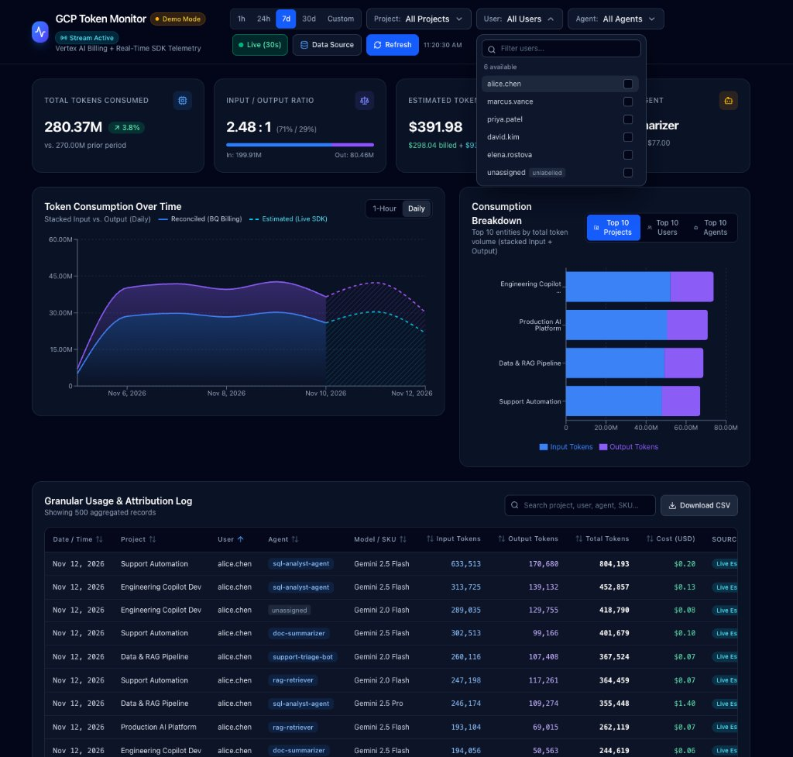
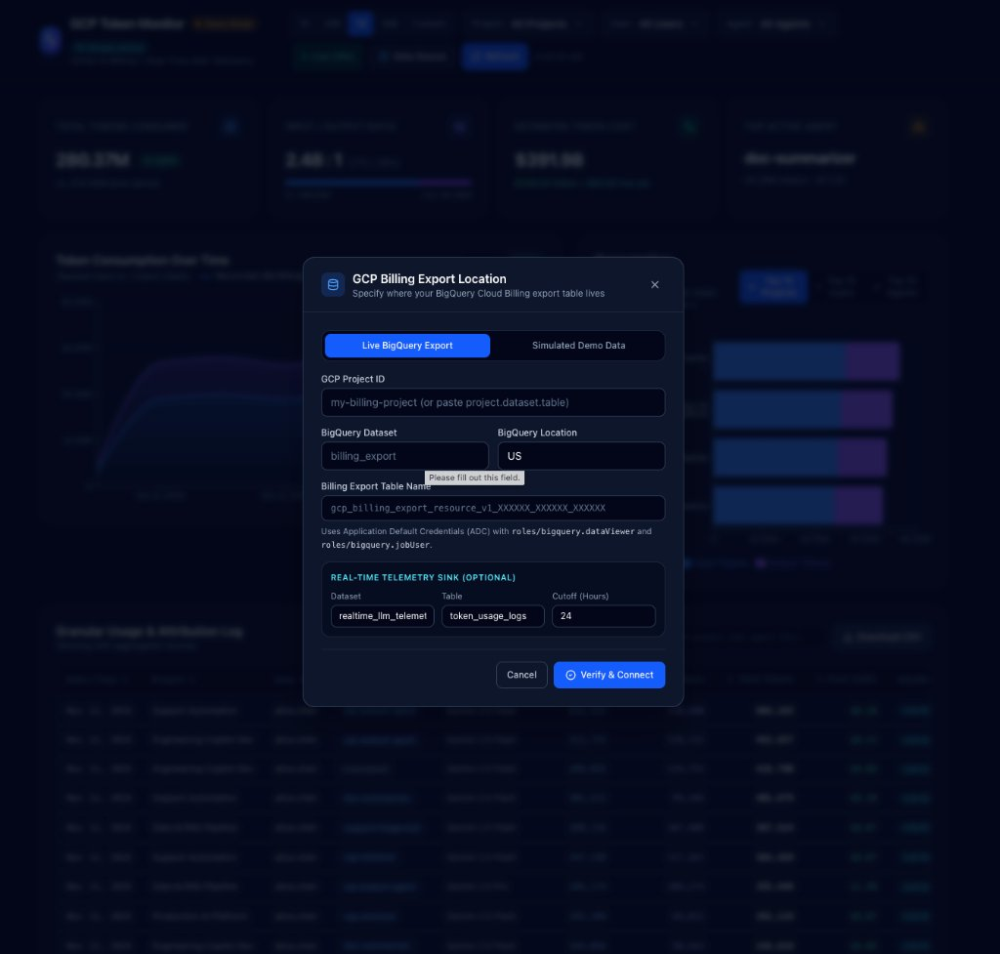

# GCP Token Monitor
### Real-Time & Reconciled LLM Observability for Vertex AI & Gemini

**Customer Pitch & Live Demo Deck**
*FinOps • Platform Engineering • AI/ML Teams*

<!--
Speaker Notes:
Welcome the customer. Frame the conversation around visibility and cost control as they move Gemini / Vertex AI agents from prototype to production.
-->

---

## The Challenge: Two Blind Spots at Scale

1. **12–24 Hour Billing Export Lag**
   - Standard GCP Cloud Billing exports don't show runaway agent loops or prompt spikes until the next day.
2. **Project-Only Attribution**
   - Native billing tells you *which GCP project* spent money—not *which user*, *which AI agent*, or *which model* drove it.
3. **Accuracy vs. Speed Trade-off**
   - Teams are forced to choose between raw SDK estimates or delayed invoice numbers.

<!--
Speaker Notes:
Ask the customer: "Today, if an AI agent gets stuck in a retry loop at 10 AM, how long before you notice it in your GCP billing?"
-->

---

## The Solution: Hybrid "Lambda" Architecture

**One dashboard combining financial accuracy and operational speed—with zero extra infrastructure.**

| Layer | Data Source | Purpose |
| :--- | :--- | :--- |
| **Historical (>24h)** | BigQuery Cloud Billing Export (`gcp_billing_export_resource_v1_*`) | **Reconciled** invoice costs (includes CUDs & credits) |
| **Live Window (Last 24h)** | Cloud Logging Sink → Partitioned BigQuery (`realtime_llm_telemetry`) | **Estimated** real-time token & cost telemetry |
| **Cutoff Boundary** | Configurable `REALTIME_CUTOFF_HOURS` | **Prevents double-counting** when billing catches up |

<!--
Speaker Notes:
Emphasize "zero extra infrastructure"—no Kafka, no Redis, no separate time-series DB. It uses Cloud Logging + BigQuery + Cloud Run.
-->

---

## Scene 1: Executive KPIs & Cost Confidence



- **Total Tokens Consumed** with `%` change vs. prior period
- **Input / Output Ratio** to spot oversized RAG context windows
- **Estimated Token Cost**: explicit split between **billed** + **live est.**
- **Top Active Agent** by token volume

<!--
Speaker Notes:
Point to the Estimated Token Cost card ($298.04 billed + $93.94 live est.). Finance trusts the billed number; engineering gets immediate visibility.
-->

---

## Scene 2: Eliminating the 24-Hour Blind Spot

### Visual Distinction: Reconciled vs. Live Telemetry
- **Solid Area**: Finalized BigQuery Billing (`Reconciled`)
- **Dashed & Hatched Area**: Live SDK Telemetry (`Estimated`)
- **Incident Response Mode**:
  - Switch to **1h** preset → automatic **1-Min** granularity
  - Enable **Live (30s)** auto-refresh polling
  - Monitor stream health via the **Stream Active** badge

<!--
Speaker Notes:
Click the 1h preset and toggle Live (30s) in the UI. Hover over a dashed bucket to show the tooltip: "Estimated from live SDK telemetry — pending BQ billing reconciliation."
-->

---

## Scene 3: Multi-Dimensional Attribution & Chargeback



- **Breakdown Tabs**: Top 10 **Projects**, **Users**, **Agents**, and **Models**
- **Multi-Select Filters**: Searchable dropdowns across all 4 dimensions
- **Graceful Fallback**: Unlabelled or legacy requests group cleanly under `unassigned`

<!--
Speaker Notes:
Show how easy it is to isolate a single agent or user for showback/chargeback, while still seeing unlabelled legacy spend under 'unassigned'.
-->

---

## Scene 4: Auditability & 2-Minute Onboarding



- **Granular Attribution Log**: Sort, search, inspect `Reconciled` vs `Live Est.`, and **Download CSV**
- **Self-Service Data Source Dialog**: Paste `project.dataset.table`—the app verifies IAM and **auto-provisions** the partitioned real-time BigQuery table if missing

<!--
Speaker Notes:
Click Data Source in the top bar to show how fast a customer can connect their own BigQuery billing export—no code changes or redeploys required.
-->

---

## Drop-In SDK Instrumentation (Python & Node.js)

Wrap `generateContent` and `generateContentStream` to stream `usageMetadata` to Cloud Logging:

```python
response = generate_content_with_telemetry(
    client,
    model="gemini-2.5-flash",
    contents=prompt,
    project_id="prod-ai-platform",
    user_id="alice.chen",
    agent_id="doc-summarizer",
)
```

- Captures `promptTokenCount`, `candidatesTokenCount`, `cachedContentTokenCount`, `modelVersion`, and `durationMs`
- Also supports standard Vertex AI request `labels: { user_id, agent_id }` for BigQuery Billing attribution

<!--
Speaker Notes:
Show that adoption is a 5-line wrapper in Python or Node.js—no custom telemetry collectors to manage.
-->

---

## Enterprise Security & BigQuery Cost Control

- **Authenticated by Default**: Deployed on Cloud Run with `--no-allow-unauthenticated` (IAM / IAP gated)
- **Least-Privilege IAM**: Uses Application Default Credentials (ADC) with `roles/bigquery.dataViewer` and `roles/bigquery.jobUser`
- **Cost-Optimized SQL**:
  - Partition pruning on `_PARTITIONTIME` and `usage_start_time`
  - Column pruning & scalar `UNNEST(labels)` subqueries (no row multiplication)

<!--
Speaker Notes:
Address FinOps and InfoSec concerns upfront: querying the billing export won't cause full-table scans, and the dashboard never needs public internet exposure.
-->

---

## Next Steps: Deploy a Live POC in <10 Minutes

1. **Try Demo Mode** immediately (no GCP credentials required)
2. **Deploy to Your GCP Project** via `DEPLOY_GCP.md` or **Antigravity**:
   ```bash
   gcloud run services proxy token-monitor --region us-central1 --port 8080
   ```
3. **Connect Your Billing Export** in the **Data Source** dialog

**Repository**: `https://github.com/bapimohanty-goog/TokenMonitor`
**Guides**: `DEMO_GUIDE.md` • `DEPLOY_GCP.md` • `README.md`

<!--
Speaker Notes:
Propose a 15-minute working session with their Platform/FinOps lead to deploy into a sandbox project and connect their billing export table.
-->
